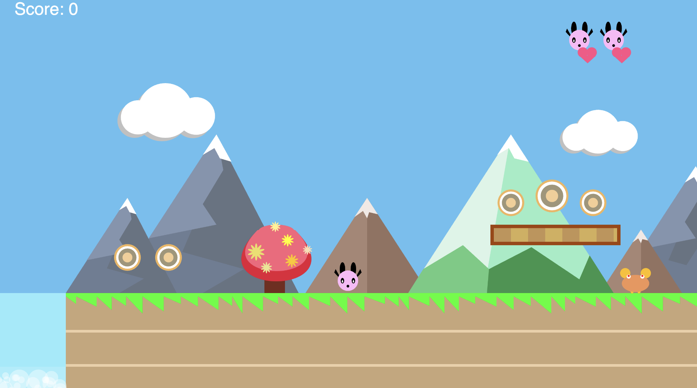

# crab-canyon-run

First-year creative coding project

p5.js side-scrolling platformer with parallax scenery, scrolling world coordinates, canyons, brick platforms (factory objects), patrolling enemies, coins, lives, flagpole win state, and a sound layer.

## Demo link:

### Controls

- Move forward -> right arrow key
- Move backward -> left arrow key
- Jump up -> space bar

### Features
 
 Side-scrolling, canyon constraint, platforms, enemies, collectibles score, lives

### How to play

- Keep moving forward, collecting coins, until you reach the flagpole at the end
- Jump over canyons and enemies
- Jump up onto platforms to cross larger canyons

### Game rules

- Character must be under a platform to jump up onto it
- Player loses a life if character collides with an enemy character, or if character falls into a canyon
- Player has 3 lives - game is over when all 3 lives are lost
- Game is over when player has reached the flag at the end
- Score is increased by 1 point for each coin collected

### Tech

p5.js, p5.sound, JS

### Notes and credits

- Background Music:
	* levelcomplete.wav - Sound from plasterbrain from Freesound.org
	* gameoversound.wav - Create by Mativve from Freesound.org
	* Other audio was made using royalty free sound loops.
	* Royalty free audio loops from 
		* https://www.humblebundle.com/software/mega-sound-designer-loop-crate-vol-2-software
	* Software Used : Audacity (freeware), Mixcraft 8 Home Studio (from humblebundle.com)

- Sound effects for actions:
	* This was generated using sfxr software (http://www.drpetter.se/project_sfxr.html, freeware).
	* Soundfile for JumpSound was taken from coursework.
